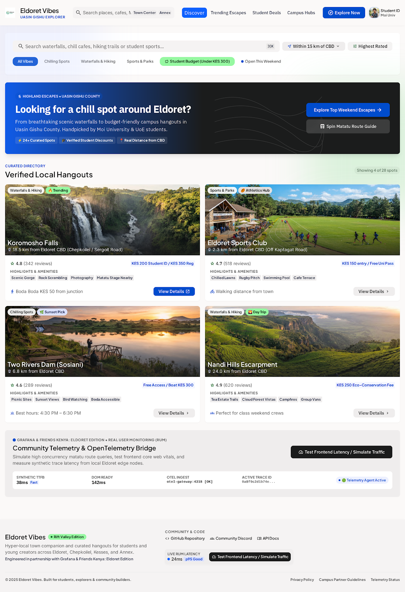

# Eldoret Vibes – Highland Explorer

A hyper-local Rift Valley travel and student companion for hangouts, scenic waterfalls, hiking trails, sports clubs, and tea escarpments across **Eldoret (Uasin Gishu County)** and **Kapsabet (Nandi County)**.

Built as a container-ready **Node.js/Express** full-stack application configured for **Google Cloud Run (port 8080)** and prepared for **Grafana Faro Web SDK (Real User Monitoring - RUM)**.

---

## Website Screenshots



*Eldoret & Kapsabet Vibes UI: Curated Directory, Search & Filter Bar, Highland Escapes Hero, Destination Cards with Modal Details, and Grafana Community Telemetry Live Dock.*

---

## 🎨 Step 1: Google Stitch UI Prompt

Use this prompt in **Google Stitch** to generate the initial UI/UX interface:

```text
Act as an expert UI/UX designer and frontend engineer. Design a modern, responsive web application UI named "Eldoret Vibes" for university students and visitors discovering local hangouts, nature spots, and weekend escapes across Eldoret and Uasin Gishu County.

Layout & Architecture:

Header & Navigation:

Sleek header featuring the "Eldoret Vibes" logo/title, a search input, and interactive pill-style filter tags (Chilling Spots, Waterfalls & Hiking, Sports & Parks, Student Budget).

Hero Banner:

Engaging callout asking: "Looking for a chill spot around Eldoret?" with a quick CTA to explore top destinations.

Destination Grid:

A responsive card grid highlighting popular local attractions such as Koromosho Falls, Eldoret Sports Club, Two Rivers Dam, and Nandi Hills Overlook.

Each card must display: image placeholder, location/distance from Eldoret CBD, entrance/activity fee in KES, rating badge, and a 'View Details' CTA button.

Interactive Detail Modal:

A overlay pop-up triggered when a card is selected, showing rich details, operating hours, student discounts, and a 'Get Directions' button.

Footer & Telemetry Hook:

Clean footer featuring Grafana & Friends Kenya: Eldoret Edition event credits.

Include a prominent action button labeled "Test Frontend Latency" (or "Simulate Traffic") designed to trigger synthetic frontend events for real user monitoring.

Style & Theme:

Color Palette: Rich highland green and warm emerald accents balanced with sleek neutral grays (#0F172A, #059669, #F8FAFC).

UI Elements: Rounded corners (border-radius: 12px), subtle elevation shadows, high-contrast typography, and clean micro-interactions.
```

---

## 🚀 Step 2: Google AI Studio Prompt

Use this prompt in **Google AI Studio Build** to turn the Stitch design into a container-ready full-stack application:

```text
Take this Stitch UI design and build a container-ready Node.js/Express application listening on port 8080 (ready for Google Cloud Run).

Functional Requirements:
1. Serve the frontend layout dynamically using Express static files or inline HTML.
2. Implement mock data for Kapsabet destinations so clicking 'View Details' opens a modal with details.
3. Make it Grafana Faro Web SDK Ready for me to add the CDN script manually.
4. Provide a clean Dockerfile exposing port 8080 for deployment.
```

---

## ✨ Features & Architecture

- **Full-Stack Express & Vite SPA**: Serves pre-built static client assets in production and Vite middleware in local development. Includes an inline server-side rendered layout route at `/dynamic` and health checks at `/health`.
- **Kapsabet & Eldoret Destinations**: Rich mock datasets covering:
  - **Kingwal Swamp Sitatunga Sanctuary** (Kapsabet wetland sanctuary for rare semi-aquatic antelopes)
  - **Chepkiit Waterfalls & Kipkaren Gorge** (hanging suspension footbridge & basalt cascades)
  - **Kapsabet Athletic Ground & Kipchoge Track** (the world's cradle of marathon champions)
  - **Chemomi Tea Estate & Nandi Overlook** (rolling tea ridges & Rift Valley views)
  - **Nandi Rock / Sheu Morobi Cliff** (1,000m sheer drop-off cliff and hiking routes)
  - **Kiborgok / Tindinyo Forest Falls** (indigenous rainforest plunge pool & nature trail)
  - **Koromosho Falls & River Sosiani Gorge**, **Eldoret Sports Club**, **Two Rivers Dam**, and more.
- **Interactive Detail Modal**: Displays location metadata, entry fees with student ID discounts, practical Matatu and Boda Boda transit guides, and telemetry traces.
- **Grafana Faro Web SDK v2**:
  - Initialized from npm in `src/faro.ts` with web vitals, errors, tracing, navigation tracking, and Session Replay.
  - Built-in "Configure Grafana Faro" drawer showing live telemetry events.
  - Telemetry service dispatching real-time RUM events (`view_destination`, `directions_requested`, `route_selected`, `search_query_changed`).
- **Google Cloud Run Ready**:
  - Configured to bind on `0.0.0.0` and `process.env.PORT || 8080`.
  - Multi-stage `Dockerfile` with non-root user execution (`USER node`).

---

## 🛠️ Getting Started

### Prerequisites
- Node.js 22+
- npm 10+
- Docker (optional, for container deployment)

### 1. Install Dependencies
```bash
npm install
```

### 2. Run Local Development Server
```bash
npm run dev
```
The server starts locally at `http://localhost:3000`.

### 3. Build for Production
```bash
npm run build
```
Builds the client SPA into `/dist` and bundles the Express server.

### 4. Run Production Server Locally
```bash
NODE_ENV=production PORT=8080 npm start
```
Open `http://localhost:8080` in your browser.

---

## 🐳 Docker & Google Cloud Run Deployment

### Build the Docker Container
```bash
docker build -t eldoret-vibes:latest .
```

### Run the Container Locally on Port 8080
```bash
docker run -p 8080:8080 -e PORT=8080 eldoret-vibes:latest
```
Access the application at `http://localhost:8080`.

### Deploy Directly to Google Cloud Run
```bash
gcloud run deploy eldoret-vibes \
  --source . \
  --platform managed \
  --region europe-west2 \
  --allow-unauthenticated \
  --port 8080
```

---

## 📊 Grafana Faro Frontend Observability

Grafana Faro Web SDK v2 is installed from npm (`@grafana/faro-react`, `@grafana/faro-web-tracing`, `@grafana/faro-instrumentation-replay`). Run `npm install` after checkout to install the SDK and generate/update the lockfile.

- **Setup**: `src/faro.ts` calls `initializeFaro` with the Grafana Cloud collector URL, app name/version, and `import.meta.env.MODE` as the environment. It is imported as the very first line of `src/main.tsx`, so Faro starts before React renders.
- **Instrumentations**: default web instrumentations (errors, console, web vitals, sessions), `TracingInstrumentation` for fetch/XHR traces, and experimental automatic navigation tracking (`trackNavigation`).
- **Session Replay (strict masking)**: `ReplayInstrumentation` blocks `.grafana-block`, images, SVGs, media, canvases, iframes, embeds, and hidden inputs from recordings. Add `.grafana-block` to any element that must never be captured, or `.grafana-ignore` to ignore its interactions.
- **Noise filtering**: ResizeObserver loop warnings, opaque `Script error.` messages, and browser extension errors are ignored.
- **Custom events**: `src/services/faro.ts` (`faroService`) forwards app events through `faro.api.pushEvent`, with attribute values stringified.
